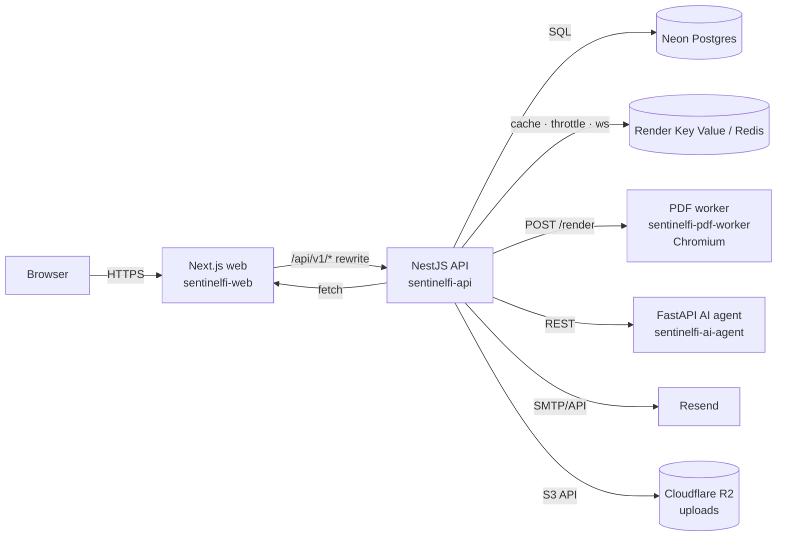

# SentinelFi — Production Deployment Guide

> **Status:** authoritative. Supersedes `docs/business/FREE_DEPLOYMENT_STRATEGY.md`.
> **Target stack:** Neon (Postgres) · Render (compute + Redis) · Resend (email) · Cloudflare R2 (object storage) · Docker.

This guide takes you from a bare GitHub repo to a running production system:
API, web app, PDF render worker, AI agent, cache/rate-limit store, transactional
email, and durable upload storage. It also closes the gaps that would otherwise
make the system unusable in production (PDF rendering, uploads, rate limiting,
health checks).

---

## 0. Architecture



Service map (see `render.yaml`):

| Service | Type | Runtime | Public? | Purpose |
|---|---|---|---|---|
| `sentinelfi-api` | web | Docker (`backend/Dockerfile`) | yes | REST/WS API |
| `sentinelfi-web` | web | Docker (`frontend/Dockerfile`) | yes | Next.js UI + proxy |
| `sentinelfi-pdf-worker` | web | Docker (`backend/Dockerfile.worker`) | yes (token) | Chromium PDF rendering |
| `sentinelfi-ai-agent` | web | Docker (`ai-agent/Dockerfile`) | internal-ish | AI orchestration |
| `sentinelfi-redis` | keyvalue | managed | no | cache, throttle, sockets |
| Neon | managed | — | no | primary database |
| Cloudflare R2 | managed | — | no | file uploads |

**Why the PDF worker is separate.** Rendering a PDF needs a real Chromium
(~300–500 MB RSS). The API runs on a 512 MB free instance; hosting Chromium
inside it both starves the API and OOMs mid-render. `backend/src/worker.ts`
runs a single warm browser and exposes one authenticated endpoint
(`POST /render`). The API delegates to it only when `PDF_WORKER_URL` is set.

---

## 1. Prerequisites

- GitHub repo pushed (`origin/master`). The Dockerfiles build **from the repo root**.
- A [Render](https://render.com) account (GitHub login; a card is required to
  create paid instances, but free web + free Key Value work without one).
- A [Neon](https://neon.tech) project (free tier is enough to start).
- A [Resend](https://resend.com) account **and a domain you control** (for SPF/DKIM).
- A [Cloudflare](https://dash.cloudflare.com) account with R2 enabled.
- Local tooling to generate secrets: Node 20+, `openssl` (Git Bash ships it).

---

## 2. ⚠️ FIRST: rotate leaked credentials (do not skip)

Live secrets were committed to tracked files **before** the deployment work:

- Neon password `npg_...` inside ~15 files under `backend/scripts/` and `scripts/tmp/`.
- Tenant user password inside `scripts/tmp/test_saen_wbs.js`, `test_projects_500.js`, `reset_saen*.js`.
- Pooler connection strings inside `scripts/tmp/*.mjs`.

Those files are on GitHub history. **Rotating is mandatory; purging is separate.**

### 2.1 Rotate

1. **Neon DB password** — Neon Console → Project → Roles → `neondb_owner` (or your
   role) → *Reset password*. Copy the new pooled + direct strings.
2. **Tenant user password** — via the app's password-reset flow, or directly:
   ```sql
   ALTER ROLE solution_energy WITH PASSWORD '<new-strong-password>';
   ```
3. **Any third-party keys** exposed in those files (Paystack/Resend) — regenerate
   in their dashboards.

After rotation the old strings are inert even if history leaks.

### 2.2 Purge from git history

```bash
# One-time, rewrites history — coordinate with anyone else who has cloned.
pip install git-filter-repo
git filter-repo --path scripts/tmp/ --path backend/scripts/ --invert-paths
git push --force origin master
```

Then confirm nothing is left:
```bash
git log --all -p -S 'npg_' --oneline | Select-String npg_
```

### 2.3 Prevent recurrence

- Keep scratch scripts in `/.workspace-temp/` (gitignored) — never in `scripts/tmp/`.
- `.env` files (`backend/.env`, `backend/.env.local`, `frontend/.env.local`,
  `ai-agent/.env`) are already gitignored. Keep it that way.

---

## 3. Database — Neon Postgres

1. Create the project, pick the region **closest to your Render region**.
2. Copy two connection strings (Neon shows them in *Connection Details*):
   - **Pooled** (`...-pooler...`): use as `DATABASE_URL` for the running API.
   - **Direct** (no `-pooler`): use only for migrations — poolers don't support
     every DDL statement and can hold long transactions.
   - Append `?sslmode=require` to both.
3. **Migrations.** Run them as a one-off, not (only) at boot. From your machine
   with the direct URL:
   ```bash
   set DATABASE_URL=postgresql://...direct...?sslmode=require
   npm run typeorm:run
   npm run typeorm:public:run     # if you use the split public/tenant runners
   ```
   > **Known gap:** migrations currently also run at boot, which races when you
   > scale the API to >1 instance. Until boot-migrations are gated behind an env
   > flag (tracked in §14), keep the API at 1 instance or run migrations as a
   > Render **pre-deploy command** (`npm run typeorm:run`) with the direct URL.
4. **Seeding.** One-off:
   ```bash
   npm run seed:superadmin -w backend   # creates the first SuperAdmin
   npm run db:seed:roles-permissions
   ```

---

## 4. Email — Resend

1. In Resend → *Domains* → add your domain (e.g. `yourdomain.com`).
2. Add the DNS records Resend shows (SPF `TXT`, DKIM `CNAME`/`TXT`, and a DMARC
   `TXT` you should add yourself). Wait for **Verified**.
3. Create an API key (send-only is fine).
4. Set on `sentinelfi-api`:
   - `EMAIL_PROVIDER=resend`
   - `RESEND_API_KEY=re_...`
   - `EMAIL_FROM=SentinelFi <notifications@yourdomain.com>` — the domain **must**
     be the verified one.
5. Send a test (register a user, or trigger a password reset) and confirm delivery
   in Resend → *Logs*.

> The API defaults `EMAIL_PROVIDER` to `resend`, and `resend.provider.ts` reads
> `RESEND_API_KEY`; the from-address is `EMAIL_FROM` (shared with the SMTP
> provider). No code change needed.

---

## 5. Cache / Rate limiting / WebSockets — Redis

1. `render.yaml` already creates `sentinelfi-redis` (Render Key Value, free) and
   wires `REDIS_URL` into the API via `fromService`.
2. **Verify** the API actually connects after deploy (see §10). Earlier this
   project pointed at an Upstash host that failed DNS (`ENOTFOUND`) and silently
   fell back to an in-process cache.

> **Known gap:** the HTTP throttler (`@nestjs/throttler`) is still configured
> with in-memory storage (`backend/src/app.module.ts`). With Redis present, move
> it to `ThrottlerStorageRedisService` so limits are global across instances
> (tracked in §14). The cache store itself already uses Redis.

---

## 6. Object storage — Cloudflare R2

Local disk uploads disappear on every deploy/restart (ephemeral container FS), so
production uploads go to R2 through `ObjectStorageService`
(`backend/src/common/storage/object-storage.service.ts`), which wraps the
S3-compatible API and automatically falls back to local disk (`uploads/`) when
the `R2_*` env vars are absent — so local dev and CI keep working unchanged.
The two Multer upload sites (billing receipts, superadmin budget import) use
in-memory storage and hand buffers to the service; the budget import is
parsed later (see §14) and is not persisted.

1. R2 → *Create bucket* (e.g. `sentinelfi-uploads`). Keep it **private**.
2. R2 → *Manage R2 API Tokens* → create a token with **Object Read & Write** for
   that bucket. Note the `Access Key ID`, `Secret Access Key`, and your account's
   S3 endpoint `https://<accountid>.r2.cloudflarestorage.com`.
3. Set on `sentinelfi-api`:
   - `R2_ACCOUNT_ID`, `R2_ACCESS_KEY_ID`, `R2_SECRET_ACCESS_KEY`
   - `R2_BUCKET=sentinelfi-uploads`
   - `R2_ENDPOINT=https://<accountid>.r2.cloudflarestorage.com`
   - (optional) `R2_PUBLIC_BASE_URL` if you want `payment_proof_url` to store a
     public URL instead of the bare object key.
4. If the browser uploads directly (presigned PUT), add a bucket CORS rule
   allowing your `FRONTEND_URL` origin, `PUT`, and the `Content-Type` header.
   (Not required today — all uploads go through the API.)

---

## 7. Deploy to Render

1. Render Dashboard → **New +** → **Blueprint** → select the repo. Render reads
   `render.yaml` and lists all services.
2. Fill every `sync: false` value (Render prompts you):

   | Service | Key | Value |
   |---|---|---|
   | api | `DATABASE_URL` | Neon **pooled** string + `?sslmode=require` |
   | api | `FRONTEND_URL` | `https://sentinelfi-web.onrender.com` (or custom domain) |
   | api | `FRONTEND_ALLOWED_ORIGINS` | extra origins (comma-separated) or the same |
   | api | `RESEND_API_KEY` | `re_...` |
   | api | `EMAIL_FROM` | `SentinelFi <notifications@yourdomain.com>` |
   | api | `AI_AGENT_URL` | `https://sentinelfi-ai-agent.onrender.com` |
   | api | `PDF_WORKER_URL` | `https://sentinelfi-pdf-worker.onrender.com` |
   | web | `FRONTEND_URL` | same as API's `FRONTEND_URL` |
   | web | `NEXT_PUBLIC_WS_URL` | `wss://sentinelfi-api.onrender.com` |
   | ai-agent | `OPENROUTER_API_KEY` / `GEMINI_API_KEY` | provider keys |
   | ai-agent | `AI_AGENT_ALLOWED_ORIGINS` | must include `FRONTEND_URL` |

   `JWT_SECRET` and `PDF_WORKER_TOKEN` are generated by Render automatically
   (`generateValue: true`); the token is shared between API and worker through the
   `sentinelfi-pdf-shared` env group so they always match.
3. **Apply.** First build takes several minutes (monorepo install + build).

### 7.1 Ports and health checks

- The API honors `PORT` and binds `0.0.0.0` (`backend/src/main.ts`). Its health
  check is `/api/v1/health/live`.
- The PDF worker honors `PORT`/`WORKER_PORT` and health-checks `/health`.
- The AI agent now honors `$PORT` (`ai-agent/Dockerfile`), defaulting to 7860.
- The web app listens on 3000 and health-checks `/api/health`.

> **Known gap:** `/api/v1/health/live` has been observed returning **500**. If the
> API reports unhealthy, fix the live check first (tracked in §14) — Render will
> otherwise restart the instance in a loop.

---

## 8. Local Docker parity (optional but recommended)

```bash
# Copy the example and fill in real values (never commit it).
Copy-Item .env.prod.example .env.prod   # if present; else create from §7 table
docker compose up --build
```

`docker-compose.yml` runs db, redis, backend, frontend, and ai-agent. Notes:

- The compose file maps `backend` to host `3000` and `frontend` to host `3001`,
  which is **inverted** vs. local dev (frontend 3000 / backend 3001). If you use
  it, browse `http://localhost:3001` for the UI. Fix the ports if this confuses
  tooling.
- The PDF worker is not in compose; add it if you want to test the delegation
  path locally (`docker build -f backend/Dockerfile.worker`).

---

## 9. Cold starts (free tier reality)

Free Render web services spin down after ~15 min idle and take ~50 s to wake.
Consequences and mitigations:

- **PDF worker cold start:** the first report after idle will wait for Chromium
  to boot. `worker.ts` warms the browser at boot and reuses it, so only the very
  first request is slow. Keep `PDF_WORKER_TIMEOUT_MS=120000`.
- **API/web cold start:** the first user after idle waits ~50 s. A free uptime
  pinger (e.g. UptimeRobot hitting `/api/v1/health/live` every 5 min) keeps the
  API warm. Don't ping the PDF worker (it would burn the free instance hours).
- **Scale:** when traffic matters, upgrade the API to Starter and run the PDF
  worker as a paid **background/private** service with an internal URL instead of
  a public one (then set `PDF_WORKER_URL` to `http://sentinelfi-pdf-worker:3002`).

---

## 10. Post-deploy verification

Run these in order; stop and fix at the first failure.

1. **API live:** `GET https://sentinelfi-api.onrender.com/api/v1/health/live` → `200`.
2. **API ready:** `GET .../api/v1/health` → DB + Redis both `up` (Redis must not
   be `ENOTFOUND`).
3. **Web up:** open `https://sentinelfi-web.onrender.com`, confirm the app loads
   and `/api/v1/health/live` resolves through the proxy.
4. **Auth:** log in via `POST /api/v1/auth/login/tenant`; confirm an httpOnly
   `access_token` cookie is set.
5. **PDF:** `GET /api/v1/wbs/projects/:id/report-pdf` → `200`, body starts with
   `%PDF-`. (First call may be slow — worker cold start.)
6. **Email:** trigger a reset/notification; confirm the Resend log shows delivered.
7. **Upload:** upload a receipt; confirm it lands in the R2 bucket (with the
   `R2_*` vars set) or under `/uploads/billing-receipts/` locally. Then fetch
   `GET /api/v1/super/billing/subscriptions/:id/proof` and confirm it streams
   the same file.
8. **WebSocket:** open a page that subscribes to notifications; confirm the socket
   connects to `NEXT_PUBLIC_WS_URL`.

---

## 11. Environment variable reference (API)

| Var | Required | Notes |
|---|---|---|
| `NODE_ENV` | yes | `production` |
| `PORT` | yes | `3001` |
| `DATABASE_URL` | yes | Neon pooled + `?sslmode=require` |
| `JWT_SECRET` | yes | ≥16 chars (64+ recommended); Render-generate |
| `FRONTEND_URL` | yes | absolute URL, drives CORS/CSP |
| `FRONTEND_ALLOWED_ORIGINS` | no | extra WS origins, comma-separated |
| `REDIS_URL` | no | enables cache + sockets across instances |
| `EMAIL_PROVIDER` | no | defaults to `resend` |
| `RESEND_API_KEY` | yes* | required when `EMAIL_PROVIDER=resend` |
| `EMAIL_FROM` | yes* | verified-domain sender |
| `AI_AGENT_URL` | no | defaults to `http://localhost:8000` |
| `PDF_WORKER_URL` | no | when set, PDFs render out-of-process |
| `PDF_WORKER_TOKEN` | yes* | must match the worker exactly |
| `PDF_WORKER_TIMEOUT_MS` | no | default 120000 |
| `PDF_NAV_TIMEOUT_MS` | no | default 60000 |
| `SWAGGER_ENABLED` | no | `false` in prod |
| `PAYSTACK_SECRET_KEY` | no | billing |
| `ADS_*` | no | monetization (test provider when unset) |

\* required for the feature to actually work; Joi marks some optional so that
local dev without those features still boots.

Generate a secret if you need one manually:
```bash
node -e "console.log(require('crypto').randomBytes(48).toString('base64url'))"
```

---

## 12. Cost envelope (approximate)

| Component | Free | Paid (rough) |
|---|---|---|
| Render API | 512 MB, spin-down | Starter $7/mo |
| Render web | 512 MB, spin-down | Starter $7/mo |
| Render PDF worker | 512 MB, spin-down | $7/mo (or background) |
| Render Key Value | 25 MB, no persistence | $10/mo |
| Render AI agent | **not viable** (heavy image) | $7–25/mo |
| Neon | 0.5 GB | $19/mo |
| Resend | 3k emails/mo | $20/mo |
| Cloudflare R2 | 10 GB free, no egress | usage-based |

Minimum viable paid production: **~$50–60/mo**, dominated by the AI agent's
LibreOffice/Tesseract image and moving off spin-down.

---

## 13. Operations runbook

- **Deploys:** push to `master`; `autoDeploy: true` rebuilds changed services.
- **Migrations:** run as a Render pre-deploy step with the **direct** Neon URL.
- **Rotating JWT_SECRET:** invalidates all sessions — do it during a window.
- **Rotating PDF_WORKER_TOKEN:** update the `sentinelfi-pdf-shared` group once;
  both services redeploy with the new value.
- **Backups:** Neon point-in-time restore; R2 versioning on the bucket.
- **Logs:** each service streams structured logs; `worker.ts` logs JSON with a
  correlation id (`x-correlation-id`) for tracing render calls.

---

## 14. Tracked gaps to close (honest status)

These are known and intentionally documented rather than hidden:

1. **Boot-migration race** — gate boot migrations behind an env flag; prefer
   pre-deploy migration jobs.
2. **AI-agent image size** — LibreOffice/Tesseract may exceed the free disk; split
   the document-tooling deps into an on-demand worker or use a paid instance.
3. **SSE chat stream** — `POST /api/v1/ai/chat/stream` currently returns a plain
   object from the controller; it needs `@Res()`/`@Sse()` wiring to actually stream
   and must set `X-Accel-Buffering: no` behind proxies.
4. **Superadmin budget-import** — `initialBudgetFile` is accepted (now in memory)
   and carried through to `tenantService.createTenant`, but its contents are not
   yet parsed into the new tenant's budget.
5. **Frontend build-time backend URL** — `BACKEND_INTERNAL_URL` is baked into the
   Next.js build via an ARG; confirm Render passes it as a build arg, otherwise set
   it explicitly in the service's build settings.

---

## 15. Troubleshooting

| Symptom | Likely cause | Fix |
|---|---|---|
| API restarts in a loop | `/health/live` 500 | fix health check (§14.3) |
| PDF endpoint 500 after idle | worker not set / cold start | set `PDF_WORKER_URL`, raise timeout |
| PDF 500 immediately | token mismatch | same `PDF_WORKER_TOKEN` on both |
| App loads, API 502 | proxy rewrite target wrong | set `BACKEND_INTERNAL_URL` at build |
| Emails "queued" but not delivered | domain not verified / wrong `EMAIL_FROM` | finish Resend DNS |
| Everything slow after idle | free-tier spin-down | uptime ping / upgrade |
| Redis "ENOTFOUND" | stale/mistyped host | use Render-provided `REDIS_URL` |
| Uploads vanish after deploy | R2 not configured | set `R2_*` env on the API (§6) |

---

## 16. References

- `render.yaml` — the Blueprint.
- `backend/Dockerfile` — API image.
- `backend/Dockerfile.worker` — Chromium PDF worker image.
- `frontend/Dockerfile` — Next.js image.
- `ai-agent/Dockerfile` — FastAPI image.
- `backend/src/worker.ts` — worker contract (`POST /render`, `GET /health`).
- `backend/src/common/pdf-generation.service.ts` — delegation logic.
- `backend/src/common/config/env-validation.schema.ts` — env contract.
